<!-- Generated by tools/build.mjs. Edit the DATA block there, then run npm run build in tools/. -->

<a href="https://github.com/saifdev9?tab=repositories">
<picture>
<source media="(max-width: 600px), (min-width: 768px) and (max-width: 900px)" srcset="assets/hero-phone.svg">
<source media="(max-width: 1199px)" srcset="assets/hero-mid.svg">

</picture>
</a>
<a href="https://github.com/saifdev9">
<picture>
<source media="(max-width: 600px), (min-width: 768px) and (max-width: 900px)" srcset="assets/contributions-phone.svg">
<source media="(max-width: 1199px)" srcset="assets/contributions-mid.svg">

</picture>
</a>
<a href="https://github.com/saifdev9/gitcloner/actions">
<picture>
<source media="(max-width: 600px), (min-width: 768px) and (max-width: 900px)" srcset="assets/pipeline-phone.svg">
<source media="(max-width: 1199px)" srcset="assets/pipeline-mid.svg">

</picture>
</a>
<a href="https://github.com/saifdev9?tab=repositories">
<picture>
<source media="(max-width: 600px), (min-width: 768px) and (max-width: 900px)" srcset="assets/languages-phone.svg">
<source media="(max-width: 1199px)" srcset="assets/languages-mid.svg">

</picture>
</a>
<a href="https://github.com/saifdev9?tab=repositories">
<picture>
<source media="(max-width: 600px), (min-width: 768px) and (max-width: 900px)" srcset="assets/work-phone.svg">
<source media="(max-width: 1199px)" srcset="assets/work-mid.svg">

</picture>
</a>
<a href="https://github.com/saifdev9/gitcloner">
<picture>
<source media="(max-width: 600px), (min-width: 768px) and (max-width: 900px)" srcset="assets/repo-gitcloner-phone.svg">
<source media="(max-width: 1199px)" srcset="assets/repo-gitcloner-mid.svg">

</picture>
</a>
<a href="https://github.com/saifdev9/claude-skills">
<picture>
<source media="(max-width: 600px), (min-width: 768px) and (max-width: 900px)" srcset="assets/repo-claude-skills-phone.svg">
<source media="(max-width: 1199px)" srcset="assets/repo-claude-skills-mid.svg">

</picture>
</a>
<a href="mailto:saifdev99@gmail.com">
<picture>
<source media="(max-width: 600px), (min-width: 768px) and (max-width: 900px)" srcset="assets/footer-phone.svg">
<source media="(max-width: 1199px)" srcset="assets/footer-mid.svg">

</picture>
</a>

 

<code>mail</code> [<code>saifdev99@gmail.com</code>](mailto:saifdev99@gmail.com) 
<code>cd</code> [<code>gitcloner</code>](https://github.com/saifdev9/gitcloner) · [<code>claude-skills</code>](https://github.com/saifdev9/claude-skills)

<code>cat .secret</code>

 

Why every panel is nine columns wide: `front-end` and `&& devops` are both nine characters long. In a monospace face that makes a perfect nine-column block, so every panel on this page sits on that grid, with a tenth column kept for exit codes. The panels are drawn by [`tools/build.mjs`](tools/build.mjs): Geist and Geist Mono turned into outlines, no fonts or scripts loaded. The contribution and language charts are redrawn every day by a GitHub Action.

